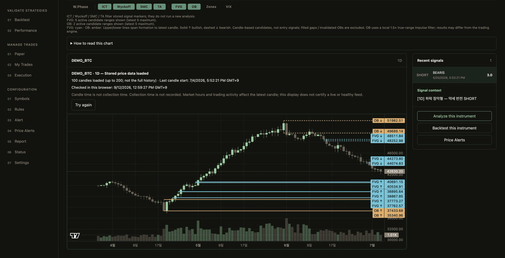

# ChartNagari

A self-hosted research workspace for Forex, US stocks and crypto — from ICT/SMC chart context to alerts and strategy review.

[Try the demo](https://ju571nk.github.io/ChartNagari/) · [Latest release](https://github.com/Ju571nK/ChartNagari/releases/latest) · [Get started](#get-started)

[English](README.md) · [한국어](README.ko.md) · [日本語](README.ja.md)

*Captured from the current main build on September 12, 2026. This short tour uses sample candles, not a live feed. [View still screenshots](docs/screenshots/README.md).*

## One place to follow your market

- **See the setup.** Explore charts in a simpler beginner view or switch to expert mode for FVG, Order Block and signal overlays.
- **Keep your context.** Carry the selected instrument and timeframe into analysis and backtesting.
- **Make alerts your own.** Manage watchlists, price alerts and Telegram/Discord notification preferences.
- **Review before acting.** Check available history, run backtests and follow paper trades without treating simulated results as predictions.
- **Set things up in the browser.** Configure data providers, optional AI and connection settings through the web UI.

English, Korean and Japanese interfaces are available. AI interpretation is optional, including a local Ollama option.

## What's new

**Latest release: [v2.16.0.0 — Optional Forex 15-minute data](https://github.com/Ju571nK/ChartNagari/releases/tag/v2.16.0.0)**

Forex pairs can opt into native 15-minute candles for charting, analysis, backtests and explicitly selected 15M alerts. Yahoo requests a 60-day history window (availability depends on Yahoo); OANDA can supply M15 when configured.

- Existing symbols, standard timeframes and alert defaults are preserved. Fifteen-minute alerts require an explicit timeframe choice; scores, cooldowns and daily caps are unchanged.
- An offline USDJPY study found insufficient evidence to change alert defaults. HTF opportunity diagnostics remain 1H/4H, and automatic penalty calibration remains disabled.

Upgrading? Preserve your existing settings and database, then restart the server. Read the [release notes](docs/releases/v2.16.0.0.md) for opt-in details and provider limits.

## Get started

Forex/FX users can follow the [5-minute keyless Forex setup guide](docs/FOREX.md).
Yahoo Finance provides default FX candles without an API key, but FX has no
meaningful volume and Yahoo gold/silver use futures proxies. The guide explains
optional OANDA eligibility, provider alignment and backtest cost limitations.
See the [Forex sample interface demo](docs/assets/forex-demo.gif); it uses sample
data and does not verify a live provider connection or release QA.

**Just looking?** [Open the browser demo](https://ju571nk.github.io/ChartNagari/). It uses bundled sample data; live collection, persistent settings and connected services require a self-hosted server.

**Ready to use your own watchlist?** Follow the [installation guide](docs/getting-started.md) for local or Docker setup. Then:

1. Add an instrument in **Symbols**.
2. Open **Chart**, choose a timeframe and start in beginner mode.
3. Visit **Settings** to connect only the data, AI or notification services you need.

Already using an older version? Read the [YAML migration guide](SETTINGS.md) before upgrading. General configuration changes need a restart; the interface identifies the relevant settings.

## A few things to know

ChartNagari is a research tool, not investment advice. FVG/OB overlays are visual candidates, not instructions to trade. Historical and paper results do not guarantee future performance.

Your database and settings are stored locally. Enabled market-data, hosted AI and notification integrations communicate with their providers; availability, fees and limits depend on those services. Saving settings does not start an execution adapter.

## Learn more

[Settings & upgrades](SETTINGS.md) · [Architecture](docs/architecture.md) · [Contributing & development](CONTRIBUTING.md) · [Order plugin developer kit](docs/order-plugin-kit.md) · [Report an issue](https://github.com/Ju571nK/ChartNagari/issues)

Built by Justin. Open source under the [MIT License](LICENSE).
