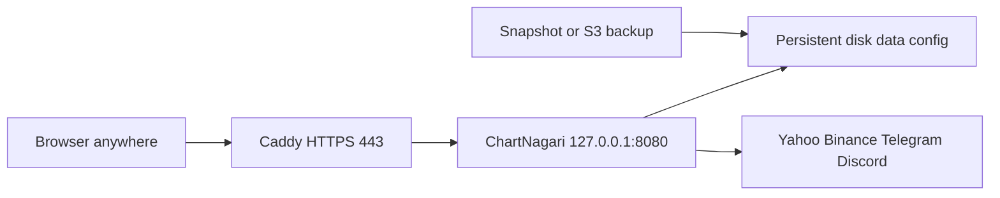

# Personal always-on ChartNagari on AWS (phase 1)

Run **one** ChartNagari box that stays up when your PC is off. This is a
single-tenant always-on host for you — not multi-user SaaS, not Marketplace, and
not a shared database.

Related reading: [Getting started](getting-started.md),
[Local and remote connections](remote-connections.md),
[Architecture](architecture.md).

## What you get

- Collectors, scoring, and Telegram/Discord alerts keep running 24/7.
- You open the same web UI from a phone or another laptop over HTTPS.
- SQLite and YAML stay on one persistent disk (one person, one instance).

## What you deliberately skip

- Per-user provisioning portals, Cognito, RDS, shared ECS services
- AWS Marketplace listing
- Local Ollama on the small always-on box (use a cloud LLM only if needed)
- Enabling execution adapters on the public host in phase 1

## Architecture



Default host: **AWS Lightsail** or a small **EC2** instance with Docker Compose.
Always-on SQLite needs a stable local disk; serverless idle savings do not apply.

Bundle files live under [`deploy/aws-personal/`](../deploy/aws-personal/) and
[`scripts/aws-personal/`](../scripts/aws-personal/).

## 1. Create the instance

Suggested starting size (adjust after you measure):

| Item | Starting choice |
| --- | --- |
| Compute | Lightsail 1 GB / 1 vCPU, or `t3.micro` / `t4g.micro` |
| OS | Ubuntu 24.04 LTS |
| Disk | 20–40 GB SSD (SQLite + candle history grows) |
| Network | Static/public IP; open **22** (your IP only), **80**, **443** |
| Region | Closest to you (or to market-data latency you care about) |

Install Docker Engine and the Compose plugin on the instance. Clone this
repository (or copy a release checkout) to a durable path such as
`/opt/chartnagari`.

```sh
sudo mkdir -p /opt/chartnagari
sudo chown "$USER":"$USER" /opt/chartnagari
# clone or rsync the project into /opt/chartnagari
cd /opt/chartnagari
```

## 2. Configure ChartNagari for remote HTTPS

Copy settings only on a **new** install. Existing installs must not overwrite
`config/settings.yaml` with the example file.

```sh
cp config/settings.example.yaml config/settings.yaml
chmod 600 config/settings.yaml
```

Apply the remote checklist in
[`deploy/aws-personal/settings.remote.snippet.yaml`](../deploy/aws-personal/settings.remote.snippet.yaml):

| Field | Value |
| --- | --- |
| `server.env` | `production` |
| `server.host` | `"0.0.0.0"` (container listens; host still binds loopback via Compose) |
| `server.port` | `"8080"` |
| `server.api_token` | ≥32 random characters (`openssl rand -hex 32`) |
| `server.remote_access` | `"true"` |
| `server.allowed_origins` | Exact HTTPS origin, e.g. `https://charts.example.com` |
| `database.path` | `./data/chart_analyzer.db` |

General settings need a **process restart** after save. Do not publish port 8080
on `0.0.0.0` at the host firewall. Leave execution plugins disabled unless you
intentionally accept that risk later.

Generate a token:

```sh
openssl rand -hex 32
```

## 3. Proxy-friendly Compose + HTTPS

Use the standalone AWS stack in
[`deploy/aws-personal/docker-compose.yml`](../deploy/aws-personal/docker-compose.yml).
It is not a Compose override: the local-dev root compose mounts host `web/dist`,
and overrides cannot remove that volume cleanly. The AWS file omits that mount
and serves the UI baked into the image.

```sh
cp deploy/aws-personal/Caddyfile.example deploy/aws-personal/Caddyfile
# Edit Caddyfile: replace charts.example.com with your DNS name
```

The stack:

- Publishes the app on `127.0.0.1:8080` for host-side checks; Caddy reaches
  `server:8080` on the Compose network
- Mounts only `data/` and `config/` from the repo root
- Runs Caddy for automatic HTTPS on ports 80/443

Point your DNS A/AAAA record at the instance IP, then:

```sh
cd /opt/chartnagari
docker compose -f deploy/aws-personal/docker-compose.yml up -d --build
docker compose -f deploy/aws-personal/docker-compose.yml ps
curl -fsS http://127.0.0.1:8080/health
curl -fsSI "https://charts.example.com/health"
```

Wire Lightsail/EC2 health checks to `/health` on the HTTPS URL or on localhost
8080 from the instance.

### Token and origin checklist

Before you treat the host as safe:

- [ ] `remote_access` is `"true"`
- [ ] `api_token` length ≥ 32 and not committed to git
- [ ] `allowed_origins` is the exact browser origin (scheme + host + port if non-default); no path, `*`, or credentials
- [ ] Host firewall / security group does **not** expose 8080 publicly
- [ ] HTTPS uses a browser-trusted certificate (Caddy/Let’s Encrypt or equivalent)
- [ ] Unauthenticated `GET /api/...` returns 401 while remote mode is on
- [ ] UI: Server connections → verify with the administrator token
- [ ] Settings → Advanced changes still require **Authorize changes** + restart when needed

See [remote-connections.md](remote-connections.md) for client/WebSocket ticket
behavior.

## 4. First use on the always-on box

1. Open `https://your-domain`, expand **Server connections**, verify with the token.
2. Add symbols; connect Telegram/Discord only if you want alerts.
3. Confirm alerts still arrive after you close the laptop.
4. Keep Ollama off this small instance.

## 5. Backup and restore

Minimum policy: **at least weekly** backups of `data/` and `config/`.

### Option A — instance / disk snapshot

- Lightsail: create an instance or disk snapshot on a schedule.
- EC2: enable EBS snapshot schedule for the data volume (or whole instance AMI).

Snapshots are the simplest full-box recovery. Test restore once before you rely
on them.

### Option B — file backup to S3

Scripts:

- [`scripts/aws-personal/backup.sh`](../scripts/aws-personal/backup.sh)
- [`scripts/aws-personal/restore.sh`](../scripts/aws-personal/restore.sh)

Example cron (weekly, Sunday 03:15 UTC):

```sh
chmod +x scripts/aws-personal/backup.sh scripts/aws-personal/restore.sh
export CHARTNAGARI_ROOT=/opt/chartnagari
export BACKUP_S3_URI=s3://your-bucket/chartnagari/personal
# Optional: stop the container briefly for a colder SQLite copy
# export BACKUP_STOP_CONTAINER=1
crontab -e
# 15 3 * * 0 CHARTNAGARI_ROOT=/opt/chartnagari BACKUP_S3_URI=s3://... /opt/chartnagari/scripts/aws-personal/backup.sh >>/var/log/chartnagari-backup.log 2>&1
```

Restore sketch:

```sh
export CHARTNAGARI_ROOT=/opt/chartnagari
export BACKUP_S3_URI=s3://your-bucket/chartnagari/personal
# pick an object key from aws s3 ls "$BACKUP_S3_URI/"
./scripts/aws-personal/restore.sh s3://your-bucket/chartnagari/personal/chartnagari-YYYYMMDDTHHMMSSZ.tar.gz
docker compose -f /opt/chartnagari/docker-compose.yml up -d
```

Stop the app before restore so SQLite is not overwritten under a live writer.

## 6. Cost note (fill after the first month)

Use [`deploy/aws-personal/cost-note.template.md`](../deploy/aws-personal/cost-note.template.md).
Hypothesis to validate:

> Monthly AWS cost + ops effort &lt; cost of leaving a PC on, or of missed alerts.

Record actual Lightsail/EC2, disk, snapshots, transfer, and domain line items.
That measured number is the floor if you later host copies for other people
(cost scales nearly linearly per instance).

## 7. Operations cheat sheet

Use `-f deploy/aws-personal/docker-compose.yml` from the repo root (or set
`COMPOSE_FILE` the same way the backup scripts do).

| Task | Command / action |
| --- | --- |
| Logs | `docker compose -f deploy/aws-personal/docker-compose.yml logs -f server` |
| Restart after YAML change | `docker compose -f deploy/aws-personal/docker-compose.yml restart server` |
| Update app | `git pull` (or new release), then `docker compose -f deploy/aws-personal/docker-compose.yml up -d --build` |
| Health | `curl -fsS http://127.0.0.1:8080/health` |
| Rotate token | New ≥32-char token in settings → restart → reconnect clients |

## Later forks (out of phase 1)

- **Clone hosting:** repeat this runbook per person (ops up, app change low).
- **Marketplace AMI/container:** buyer runs the box in their account.
- **Multi-tenant SaaS:** deferred; farthest from the current architecture.

## Security reminders

- The API token is an **administrator** credential, not a read-only user role.
- Never commit `config/settings.yaml`, tokens, or backup tarballs with secrets.
- Do not expose an unauthenticated server on the public internet.
